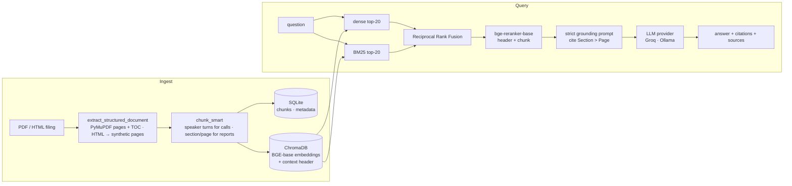

# FinSight

**Grounded question-answering and claim verification over Indian company filings — with the retrieval pipeline measured, not just built.**

FinSight ingests earnings-call transcripts, press releases and annual reports, answers questions with page-level citations from a hybrid BM25 + dense retriever with cross-encoder reranking, and checks whether management *walked the talk*: it extracts forward-looking claims from one quarter's call and grades them MET / MISSED / PARTIAL against the next period's actuals. A React dashboard wraps it with market data, watchlists and FinBERT sentiment.

[](https://github.com/BhavyaPatel19/Finsight2.0/actions/workflows/ci.yml)
[](LICENSE)


---

## In numbers

Retrieval over 8 Infosys filings (145 chunks), 64 gold questions, relevance = the retrieved chunk contains the gold evidence quote ([methodology](docs/EVALUATION.md), [history of what changed](eval/results/HISTORY.md)):

| retrieval mode | hit@1 | hit@5 | MRR@8 | nDCG@8 | ms/query |
|---|---|---|---|---|---|
| dense (BGE-base) | 0.328 | 0.578 | 0.450 | 0.513 | 32 |
| BM25 | 0.312 | 0.625 | 0.449 | 0.506 | <1 |
| hybrid (RRF) | 0.422 | 0.766 | 0.556 | 0.606 | 16 |
| **hybrid + rerank (production)** | **0.656** | **0.844** | **0.738** | **0.764** | 641–877 |

The production path started at hit@5 **0.578** — below BM25 alone — and reached **0.844** through four measured fixes, none of which changed the architecture: the reranker was scoring 512 *characters* instead of 512 tokens, BM25 hits carried no page numbers, and neither the embedder nor the reranker could tell a Q4 FY25 filing from a Q4 FY26 one until a `company · doc type · period` header was prepended at index time.

End-to-end answers on the same 64 questions, generated and judged by a local `qwen3:14b` (Groq/70B cross-check pending — [why that matters](docs/EVALUATION.md#2-generation-python--m-evalgeneration)):

| metric | value |
|---|---|
| correct vs human reference (judge) | **87.5%** (partial 7.8%, incorrect 4.7%) |
| faithfulness — answer claims supported by retrieved text (judge) | **0.947** |
| abstains on the 4 unanswerable questions | 100% |
| answers carrying a `[… Page N]` citation / cited pages actually retrieved | 95% / 100% |

Every "incorrect" answer was an abstention on a retrieval miss, not a fabricated number. The first generation run also caught a production bug: Ollama's default 2k context window silently truncated the 4k-token RAG prompt from the front, so local models never saw the grounding rules.

Walk-the-Talk results against 15 human-labelled claims: `python -m eval.wtt` → `eval/results/wtt_*.json`.

---

## What it does

| | |
|---|---|
|  | **Grounded Q&A.** Ask across selected filings; answers cite `[Section > Page N]`, show the retrieved passages, and say *"Not found in the selected documents."* rather than guess. Reasoning-model traces are shown when available. |
|  | **Walk the Talk.** Pick a "claims" document and a later "actuals" document. Stage 1 extracts forward-looking commitments (revenue, margin, capex, hiring, …); stage 2 retrieves the matching actuals and grades each claim, with an overall credibility score and narrative. FinBERT scores sentiment per business division. |
|  | **Market.** NSE quotes, candlesticks, instrument search, fundamentals and news. Works out of the box on free delayed data (yfinance); links a Zerodha Kite account for live broker data. |
|  | **Portfolio & watchlists.** Holdings synced from Zerodha, multiple watchlists with notes, and an LLM digest of the day's movers. |

---

## Architecture



**Walk the Talk** is a separate two-stage pipeline on its own section-aware chunks (3,500 chars): keyword pre-filter → batched claim extraction (JSON mode) → per-claim semantic retrieval of actuals → verdict + explanation → credibility score.

Backend: FastAPI · SQLModel/SQLite · ChromaDB · sentence-transformers · rank-bm25 · PyMuPDF · yfinance. Frontend: React 18 + Vite · Recharts · Framer Motion.

---

## Quickstart

Requirements: Python 3.12+, [uv](https://docs.astral.sh/uv/), Node 20+. Ollama is optional.

```bash
git clone https://github.com/BhavyaPatel19/Finsight2.0.git && cd Finsight2.0
make install                              # uv sync + npm ci

cp .env.example .env
#   SECRET_KEY=$(openssl rand -hex 32)                 required
#   GROQ_API_KEY=gsk_...                               recommended: free at console.groq.com; else Ollama is used
#   EDGAR_USER_AGENT="FinSight research you@example.com"   only for the sample corpus (SEC policy)

make seed                                 # download 8 public Infosys filings from SEC EDGAR, index them (~2 min, downloads BGE models on first run)
make dev                                  # API on http://127.0.0.1:8000  (Swagger at /docs)
cd frontend && npm run dev                # UI on http://localhost:5173
```

Register a user, open **Chat**, select the seeded documents and ask *"What FY26 guidance did Infosys give in April 2025, and what did it deliver?"*

**Fully local, no keys:** install [Ollama](https://ollama.ai), `ollama pull llama3.1:8b`, leave `GROQ_API_KEY` unset. Set `OLLAMA_NUM_CTX=8192` (the default) — Ollama's stock 2k window silently truncates the ~4k-token RAG prompt.

---

## Evaluation

```bash
make eval-retrieval        # 4 modes × 64 questions, ~2 min; writes eval/results/retrieval_<tag>.json + retrieval_latest.md
make eval-generation       # answers every question, deterministic checks + LLM judge; needs Groq or Ollama
uv run python -m eval.wtt  # Walk-the-Talk vs 15 human-labelled claims: recall, verdict accuracy, Cohen's κ
```

The gold set is regenerated from an authoring script that **fails if any evidence quote is missing from the source text**, so it cannot drift. Full methodology, definitions and what is *not* measured: [docs/EVALUATION.md](docs/EVALUATION.md).

---

## Design decisions

- **Hybrid retrieval with RRF, then a cross-encoder.** Financial questions are half keyword (`"attrition"`, `"$4,730"`) and half semantic; BM25 and dense each win on different questions and RRF needs no score calibration. The reranker is worth its ~600 ms only once it sees the full chunk *and* the period header — the eval history shows both.
- **Contextual headers at index time, not in the stored text.** `Infosys Ltd (INFY) · earnings call transcript · Q4 FY25` is prepended to what gets embedded, BM25-tokenised and reranked; the stored chunk stays verbatim so citations quote the filing.
- **Provider layer.** `finsight/llm/` exposes one `generate()`; Groq (hosted, free tier) and Ollama (local) are config. Responses carry model, token usage and latency; failures raise `LLMError` (the API returns 503) instead of `"[LLM error: …]"` strings that used to be parsed as answers.
- **Market data is a provider too.** yfinance by default so a fresh clone works; Zerodha Kite is an opt-in upgrade for users who link an account. Instrument search uses a bundled public NIFTY 500 list with Yahoo search as fallback.
- **HTML filings get synthetic pages.** EDGAR exhibits have no page breaks; text is cut into ~3,000-character pages at paragraph boundaries so citations stay locatable, and bold-only paragraphs become `Speaker:` lines so transcripts still chunk by turn.
- **Own judge instead of RAGAS.** The RAGAS build in the lock file could not import against current LangChain and pulled in four heavy packages; the replacement is ~100 lines on the provider layer with the prompts in the repo, plus deterministic checks (number recall, abstention, citation validity) that need no judge at all.
- **Public data only.** Everything in the sample corpus is a public SEC filing; company IR sites and BSE refuse programmatic access, and the previous User-Agent-rotating scraper was removed from the supported path.

---

## Configuration

| variable | default | purpose |
|---|---|---|
| `SECRET_KEY` | — (required) | JWT signing; startup fails without it |
| `ALLOWED_ORIGINS` | `http://localhost:5173,http://127.0.0.1:5173` | CORS |
| `LLM_PROVIDER` | `auto` | `auto` (Groq if key set, else Ollama) · `groq` · `ollama` |
| `GROQ_API_KEY`, `GROQ_MODEL` | —, `llama-3.3-70b-versatile` | hosted inference |
| `OLLAMA_BASE_URL`, `OLLAMA_MODEL`, `OLLAMA_NUM_CTX` | `http://localhost:11434`, `llama3.1:8b`, `8192` | local inference |
| `WTT_MODEL` | provider default | override for claim extraction / verification |
| `MARKET_DATA_PROVIDER` | `auto` | `auto` (Zerodha for linked users, else yfinance) · `yfinance` · `zerodha` |
| `ZERODHA_API_KEY`, `ZERODHA_API_SECRET`, `ZERODHA_REDIRECT_URI` | — | optional Kite Connect app |
| `EDGAR_USER_AGENT` | — | required by SEC to download the sample corpus |
| `DATABASE_URL`, `CHROMA_PERSIST_DIR`, `EMBEDDING_MODEL` | SQLite file, `./chroma_db`, `BAAI/bge-base-en-v1.5` | storage & embeddings |

---

## Repository map

```
finsight/           FastAPI backend
  llm/              provider layer (Groq, Ollama), /llm/models
  rag/              retrieval.py (4 modes) · service.py (index + answer) · bm25_store · reranker · vectorstore
  ingestion/        parsers (PDF + HTML) · uploads (validated) · file_manager
  credisentiment/   Walk the Talk pipeline + prompts · FinBERT division sentiment
  market/           providers (yfinance, Zerodha) · fundamentals · insights · news · bundled NIFTY 500 list
  auth/ zerodha/ portfolio/ watchlist/ credibility/ scraper/ models/
eval/               gold sets · retrieval / generation / wtt harnesses · judge · results
scripts/seed_demo.py  downloads + indexes the sample corpus
frontend/           React + Vite
tests/              125 tests (pytest); models and LLMs are stubbed, so the suite runs in ~6 s
```

---

## Limitations and roadmap

- Documents are shared across users (no per-user scoping yet); the app is single-tenant in practice.
- Answers are not streamed; the chat's typing effect is client-side.
- JWTs live in `localStorage`; Zerodha access tokens are stored unencrypted; the Zerodha OAuth flow lacks a `state` parameter. Fine for a local tool, not for a public deployment.
- The Walk-the-Talk gold set is 15 claims from one company and one labeller. Extending it (more companies, a second labeller for κ) is the next evaluation step; fine-tuning a small encoder for claim detection and an NLI cross-encoder for verdicts — with the LLM as teacher and narrator — is the planned modelling step.
- Retrieval numbers are from one corpus (Infosys, four quarters). Expect different behaviour on 200-page annual reports with real page numbers.

---

## Data and licence

Sample corpus: Form 6-K exhibits filed with the U.S. SEC by Infosys Ltd, downloaded from EDGAR at seed time (SHA-256 pinned in `eval/gold/documents.json`; not redistributed). NIFTY 500 constituent list from NSE Indices (`finsight/market/data/README.md`). Prices via Yahoo Finance (delayed) or the user's own Zerodha account.

Code is MIT licensed — see [LICENSE](LICENSE).
