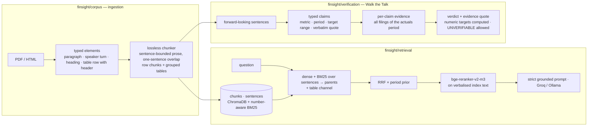

# FinSight

**Grounded question-answering and claim verification over company filings — rebuilt around measurement.**

FinSight ingests earnings-call transcripts, press releases, fact sheets and annual reports (PDF or HTML), answers questions with page-level citations, and checks whether management *walked the talk*: it extracts forward-looking commitments from one quarter's call and grades them **MET / MISSED / PARTIAL / UNVERIFIABLE** against the next period's filings, with the evidence quote for every verdict. A React dashboard wraps it with market data, watchlists and FinBERT sentiment by division.

[](https://github.com/BhavyaPatel19/Finsight2.0/actions/workflows/ci.yml)
[](LICENSE)


> **Branches.** `main` is the original project as built. This branch, `experiment/accuracy-redesign`, is a from-scratch rebuild of the accuracy-critical core — ingestion, retrieval, verification — driven by an audit of every process ([docs/PIPELINE_AUDIT.md](docs/PIPELINE_AUDIT.md)) and measured at every step ([eval/results/HISTORY.md](eval/results/HISTORY.md)).

---

## In numbers

Eight public Infosys filings (SEC EDGAR 6-K exhibits: four earnings-call transcripts, two press releases, two fact sheets, Q4 FY25 → Q1 FY27), **rendered to real multi-page PDFs** because PDF is the product's primary input. 64 gold questions with verbatim evidence quotes; a retrieved chunk counts only if it contains the quote.

| retrieval, PDF corpus | hit@1 | hit@5 | MRR@8 | evidence within first 6k chars |
|---|---|---|---|---|
| original pipeline | 0.688 | 0.875 | 0.771 | 0.859 |
| **redesign (v2)** | **0.797** | **1.000** | **0.891** | **1.000** |

Same on the HTML originals: hit@5 0.859 → 0.984. Chunk coverage — the share of questions whose evidence exists in *any* chunk — went from 96.9% to 100%, because the original chunker silently dropped 11–35% of the text of several documents.

End-to-end answers on the PDF corpus (76 questions, 12 of them unanswerable; correctness graded by a different model family, `qwen-3.8-27b`, against human references):

| generation, PDF corpus | correct | incorrect | faithfulness | false abstain | abstain on unanswerable | cited |
|---|---|---|---|---|---|---|
| original pipeline (HTML, self-judged `qwen3:14b`) | 87.5% | 4.7% | 0.947 | 6.2% | 100% (n=4) | 95% |
| v2, local `qwen3:14b` | 82.8% | 10.9% | 0.894 | 3.1% | 75% | 90% |
| **v2, `gpt-oss-120b` (Cerebras)** | **95.3%** | **1.6%** | **0.926** | **0%** | **100%** | **100%** |

Walk the Talk against 25 human-labelled claims (5 of them unverifiable — commitments whose period had not ended):

| Walk the Talk | claim recall | accuracy on graded claims | abstain recall / precision | κ |
|---|---|---|---|---|
| original pipeline (15 claims, `qwen3:14b`) | 0.80 | 0.58 | – | 0.10 |
| v2.2, local `qwen3:14b` | 0.84 | 0.83 | 1.0 / 0.56 | 0.50 |
| **v2.4, `gpt-oss-120b` (Cerebras)** | **0.92** | **0.88** | **1.0 / 0.83** | **0.76** |

The single biggest generation gain (85.9% → 95.3% on the same model) came from one parser defect: the income statement's header row sits at the foot of one page and its body at the top of the next, so every figure reached the model without a column name. Every run, what changed between runs and what each still gets wrong is in [`eval/results/HISTORY.md`](eval/results/HISTORY.md).

---

## What the audit found

Reading every process end to end, on the PDFs the product actually ingests ([full audit](docs/PIPELINE_AUDIT.md)):

- **Transcript PDFs were never recognised as transcripts** — the speaker regex needed a colon that PDF text does not have — so they were cut into fixed 1,500-character windows mid-sentence. Fact sheets *were* misdetected as transcripts by the same regex and lost 18–35% of their text to a chunker that discarded everything before the first "speaker" on each page.
- **Tables were read as one cell per line.** `find_tables()` was never called; rows lost their headers; two gold facts did not survive extraction at all.
- **Three indexing routes for one document.** The Documents page's *Process* button ran a 512-character window chunker with no page numbers, and the Chat page then trusted its output.
- **The reranker was matching headers, not content**: `bge-reranker-base` scored an irrelevant paragraph 0.69–0.75 as long as it carried the document header, and the correct fact-sheet row 0.001 without one.
- **Claim verification retrieved "actuals" per *category*** with a dense-only search over one document; four of five wrong verdicts said "the actuals do not mention…" while the fact sat in the sibling press release or fact sheet.
- Ollama's default 2k context truncated the 4k-token RAG prompt from the front; `WTT_PARALLEL=4` deadlocked a single-slot local model into returning zero claims; `passlib` broke registration on fresh installs.

---

## The second company

Every number above is Infosys — the corpus the pipeline was built against. To find out what breaks on documents it had never seen, Tata Steel's own investor-relations downloads went in as they are published: five earnings-call transcripts (Q1 FY25 – Q1 FY26) and the 550-page Integrated Report & Annual Accounts 2024-25 (manifest: `eval/gold/documents_tatasteel.json`, SHA-256 pinned). Out of the box:

- the transcripts parsed as **plain paragraphs with no speakers** — Tata Steel's labels are `Koushik Chatterjee: ED & CFO – Tata Steel Limited` / `Amit Dixit, ICICI Securities` in bold, glued by PyMuPDF to the end of the previous speaker's block;
- the annual report parsed as an **11,576-turn conversation between "NOTES", "Amount" and "Total"**;
- **page numbers landed inside sentences** ("produced its last 4 liquid steel"), because the footer number shares a text block with a paragraph that runs to the page bottom;
- the evidence query **deleted every digit**, turning "BF#4" into "BF#" and "4Q" into "Q" before the search began;
- steel-industry result verbs (*dropped, commissioned, shut, halved*) were not on the list that separates a reported result from a promise, so correct verdicts were discarded as "the evidence is a promise".

Each fix is generic and tested, and the Infosys corpus parses byte-identically after all of them. A 23-claim gold set (`eval/gold/wtt_claims_tatasteel.jsonl`: 7 MET, 5 PARTIAL, 2 MISSED, 9 UNVERIFIABLE — steel guidance is long-dated) measures the result. The clean part of the first run on the fixed pipeline (two document pairs, 7 labelled claims, before the hosted-model budget ran out) agrees with the human label on 6; the two failure modes that dominated earlier runs — a signed grant agreement graded "not received", a reported loss where breakeven was promised graded "unverifiable" — are gone. A full clean measurement is the next run; the contaminated ones (κ 0.51 with a third of the transcript unread, κ 0.34 with a broken regex) are recorded in [HISTORY](eval/results/HISTORY.md) as what they are.

What the exercise changed about the product, because a real user's company gets no gold set and no day of tuning:

- **Parse health at upload** (`finsight/corpus/health.py`): speakers, header-less table rows, page-number artefacts, chunk coverage — computed in milliseconds and stored on the document, with named warnings (`transcript_no_speakers`, `tables_without_headers`, …). Yesterday's Tata transcripts would have been flagged in the first second.
- **Per-verdict confidence** (`high / medium / low` with reasons), derived only from what the pipeline established — a numeric rule on a verified table row, a model judgement on a verified quote, a numeric target with no figure in the evidence — and shown next to every verdict with its evidence sentence and page.
- **Auto-detection of document type and period** from the first pages (`finsight/corpus/detect.py`; 14/14 on both corpora), so a folder can be dropped without a form.
- **Offline instruments** (`python -m eval.wtt --evidence-only`): does each labelled claim reach the extractor, does retrieval find its evidence — seconds, no model — so a change is judged before a run is paid for.

---

## Architecture (v2)



Two texts per chunk: the **verbatim** source (what citations quote, what the user sees) and an **index text** carrying `company · document type · period · section · speaker`, with table rows verbalised as `title — label: column = value; …`. The embedder, BM25 and the reranker all see the same enriched text.

---

## Quickstart

Requirements: Python 3.12+, [uv](https://docs.astral.sh/uv/), Node 20+. Optional: Ollama (local models), Chrome (to render the sample PDFs).

```bash
git clone -b experiment/accuracy-redesign https://github.com/BhavyaPatel19/Finsight2.0.git && cd Finsight2.0
make install                              # uv sync + npm ci

cp .env.example .env
#   SECRET_KEY=$(openssl rand -hex 32)                       required
#   GROQ_API_KEY=gsk_...                                     recommended (free at console.groq.com); else Ollama is used
#   EDGAR_USER_AGENT="FinSight research you@example.com"     only to download the sample corpus (SEC policy)

uv run python -m scripts.seed_demo --engine v2   # download 8 public Infosys filings from SEC EDGAR and index them
make dev                                          # API on http://127.0.0.1:8000 (Swagger at /docs)
cd frontend && npm run dev                        # UI on http://localhost:5173
```

Register a user, open **Chat**, select the seeded documents and ask *"What FY26 guidance did Infosys give in April 2025, and what did it deliver?"*. Open **CrediSentiment → Walk the Talk**, pick the Q4 FY25 call as claims and the Q4 FY26 call as actuals.

**Fully local:** install [Ollama](https://ollama.ai), `ollama pull qwen3:14b` (or any chat model), leave `GROQ_API_KEY` unset. The first run downloads `bge-base-en-v1.5` (embeddings) and `bge-reranker-v2-m3` (~2 GB); reranking costs ~1 s per query on Apple silicon.

---

## Evaluation

```bash
uv run python -m scripts.render_pdfs                                  # HTML exhibits → real PDFs (headless Chrome)
FINSIGHT_CORPUS=pdf uv run python -m scripts.seed_demo --format pdf --engine v2
FINSIGHT_CORPUS=pdf uv run python -m eval.retrieval --modes v2 v2_notables v2_noperiod   # hit@k, MRR, nDCG, evidence-within-6k-chars
FINSIGHT_CORPUS=pdf LLM_PROVIDER=cerebras uv run python -m eval.generation --judge-model qwen-3.8-27b   # correctness / faithfulness (independent judge) + deterministic checks
FINSIGHT_CORPUS=pdf LLM_PROVIDER=cerebras uv run python -m eval.wtt --engine v2                          # claim recall, verdict agreement, κ vs 25 human labels
make train-claim-detector                                                                              # encoder fine-tune vs regex and FinBERT-FLS baselines
```

One full cycle (generation + judge + Walk the Talk) is ≈ 970k tokens, measured on the real prompts; on Cerebras that is about $0.40 and ten minutes, on a local 14B model about 2.5 hours. `--rejudge` re-grades a finished run's answers with a different judge or rubric without regenerating them.

`FINSIGHT_CORPUS=pdf` keeps the PDF corpus in its own database and vector store so the HTML and PDF paths can be compared side by side; `--engine v1` runs the original pipeline on the same gold set. The gold set is regenerated by an authoring script that **fails if any evidence quote is missing from the source text**. Methodology, definitions and what is not measured: [docs/EVALUATION.md](docs/EVALUATION.md). Every change that moved a number, with the number: [eval/results/HISTORY.md](eval/results/HISTORY.md).

---

## Design principles of the rebuild

1. **Lossless by construction.** Parsing produces typed elements; chunking is a total function over them with a tested invariant — every element's text is in some chunk.
2. **Structure is context.** Table rows carry title and header; transcript chunks carry the speaker and the analyst question they answer; every chunk carries company, document type and period.
3. **Retrieve small, return big.** Sentences are indexed for precision and mapped back to their parent chunk; a dedicated table channel guarantees numeric questions get row candidates into fusion.
4. **Numbers are checked, not trusted.** A verdict on a numeric target (a range, "above 100%") is computed from the extracted actual; the LLM extracts, code decides.
5. **Abstain explicitly.** RAG answers "Not found in the selected documents."; verification returns `UNVERIFIABLE`, and any MET/MISSED/PARTIAL must cite a quote that is verifiably in the retrieved text or it is downgraded.
6. **Every change is a row in the history file.** Nothing lands without a before/after on the same gold set.

---

## Configuration

| variable | default | purpose |
|---|---|---|
| `SECRET_KEY` | — (required) | JWT signing; startup fails without it |
| `LLM_PROVIDER` · `GROQ_API_KEY` · `GROQ_MODEL` | `auto` · — · `openai/gpt-oss-120b` | hosted inference (enable the model in your Groq project first) |
| `CEREBRAS_API_KEY` · `CEREBRAS_MODEL` | — · `gpt-oss-120b` | same models via Cerebras; `auto` falls back to it when no Groq key is set |
| `OLLAMA_BASE_URL` · `OLLAMA_MODEL` · `OLLAMA_NUM_CTX` · `OLLAMA_TIMEOUT_S` | `http://localhost:11434` · `llama3.1:8b` · `8192` · `300` | local inference |
| `WTT_MODEL` | provider default | model for claim extraction / verification |
| `EMBEDDING_MODEL` · `RERANKER_MODEL` | `BAAI/bge-base-en-v1.5` · `BAAI/bge-reranker-v2-m3` | retrieval models |
| `MARKET_DATA_PROVIDER` · `ZERODHA_*` | `auto` · — | yfinance by default; Zerodha Kite if configured and linked |
| `FINSIGHT_CORPUS` | — | `pdf` → separate DB/vector store for the PDF eval corpus |
| `EDGAR_USER_AGENT` | — | required by SEC to download the sample corpus |
| `ALLOWED_ORIGINS` · `DATABASE_URL` · `CHROMA_PERSIST_DIR` | dev server · SQLite file · `./chroma_db` | infrastructure |

---

## Repository map

```
finsight/corpus/        ingestion v2: elements.py · parse_pdf.py · parse_html.py · structure.py (transcript gate) · chunker.py
finsight/retrieval/     index.py (chunks + sentences) · search.py (fusion, table channel, rerank) · periods.py · text.py
finsight/verification/  claims.py · evidence.py · verdict.py · pipeline.py · sentiment.py
finsight/rag/           answer_question (grounded prompt), legacy v1 index kept for the eval comparison
finsight/llm/           provider layer (Groq, Cerebras, Ollama)
finsight/ml/claims/     claim-detector dataset (LLM as teacher) and ModernBERT fine-tune; model card in docs/
finsight/market/        providers (yfinance, Zerodha) · fundamentals · news
finsight/{auth,ingestion,credisentiment,watchlist,portfolio,zerodha}/   app modules
eval/                   gold sets · retrieval / generation / wtt harnesses · judge · results + HISTORY.md
scripts/                seed_demo.py (download + index) · render_pdfs.py
docs/                   PIPELINE_AUDIT.md · REDESIGN.md · EVALUATION.md · MODEL_CARD_claim_detector.md · adr/
tests/                  225 tests; models and LLMs stubbed, runs in ~11 s
```

---

## Limitations

- The measured corpus is one company; the second (Tata Steel) exposed five parser and retrieval defects on its first pass and does not yet have a clean full measurement. Industries whose commitments are long-dated and qualitative (steel: "by 2030", "by March 2026", "we will engage with the government") yield more UNVERIFIABLE verdicts and fewer graded ones — by design, but it means less coverage than on an IT-services company. Scanned PDFs (no text layer) are flagged, not read.
- The annual report's tables: 1,519 of its 2,934 rows carry no column headers after parsing; questions over the report are not yet measured.
- Walk-the-Talk labels: 25 claims, one labeller. κ 0.76 on 23 matched claims is a direction, not a measurement, until the set is larger and a second labeller has graded it; two of the three remaining disagreements are a labelling judgement (a tax rate that came in below its guided range because of a one-off reversal).
- Correctness and faithfulness are LLM-judged (a different model family from the generator) against references written from the filings, not audited by a second person.
- Reranking with v2-m3 costs ~1 s/query; latency work (candidate pruning, batching) is not done.
- Documents are per-user; the app is otherwise single-tenant in practice. Answers are not streamed.

---

## Data and licence

Sample corpus: Form 6-K exhibits filed with the U.S. SEC by Infosys Ltd, downloaded from EDGAR at seed time (SHA-256 pinned in `eval/gold/documents.json`, not redistributed). NIFTY 500 constituent list from NSE Indices. Prices via Yahoo Finance (delayed) or the user's own Zerodha account.

Code is MIT licensed — see [LICENSE](LICENSE).
