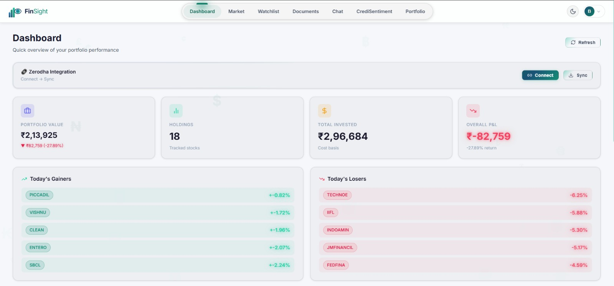
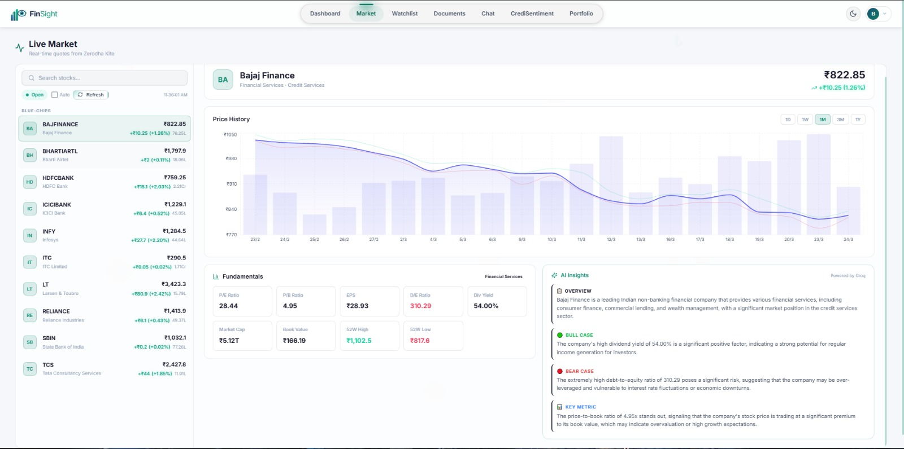
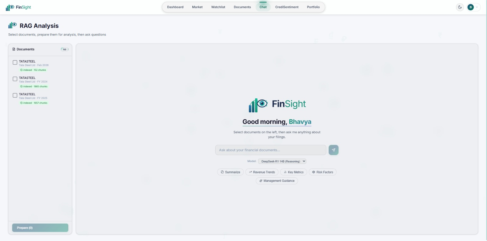
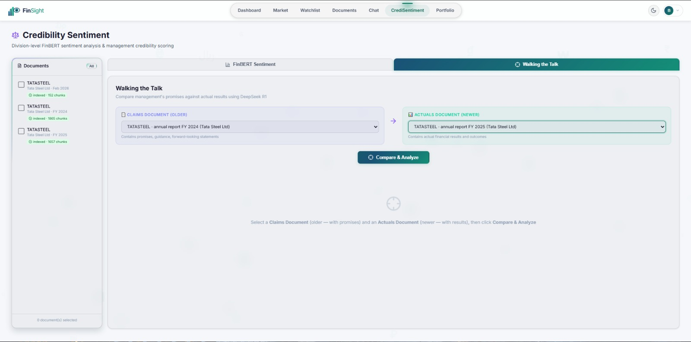

# FinSight

**AI-powered financial intelligence platform for Indian retail investors**

FinSight combines portfolio tracking, document analysis, sentiment scoring, and AI-driven insights into a single platform — designed to help retail investors make smarter, data-backed decisions.



---

## Features

### Portfolio Management
- **Zerodha Integration** — Connect your Zerodha Kite account via OAuth 2.0, sync holdings automatically
- **Holdings Dashboard** — View quantity, average price, current price, P&L, and day change at a glance
- **Portfolio Insights** — AI-generated summary of your portfolio composition and performance

### Live Market Data
- **Real-time Quotes** — Fetch live market data for any NSE/BSE instrument
- **Historical Charts** — Candlestick charts with multiple intervals (1min, 5min, 15min, daily)
- **Instrument Search** — Search across 100,000+ instruments by symbol or name
- **Fundamental Metrics** — PE, ROCE, EPS, debt-to-equity, promoter holding, 52-week range, and more
- **AI Market Insights** — Groq-powered analysis of stock fundamentals
- **Stock News** — Google News RSS integration for stock-specific headlines



### Document Intelligence (RAG)
- **PDF Upload & Processing** — Upload annual reports, quarterly filings, earnings call transcripts
- **BSE Document Scraper** — Search and download company filings directly from Screener.in
- **Page-Aware Chunking** — Intelligent text extraction preserving page and section context
- **Semantic Search** — ChromaDB vector store with Sentence Transformer embeddings (BAAI/bge-base-en-v1.5)
- **RAG Chat Interface** — Ask questions about your documents with source citations and thinking trace
- **Multi-Model Support** — Choose between Llama 3, DeepSeek R1, Qwen, or Groq cloud models
- **RAGAS Evaluation** — Built-in evaluation for faithfulness, answer relevancy, and context precision



### CrediSentiment Analysis
- **Division-Level Sentiment** — FinBERT-powered sentiment scoring broken down by business divisions
- **Section-Aware Processing** — Independent chunking pipeline (3500 chars) preserving document structure
- **Walk the Talk** — Compare management claims from one period against actual results from the next
  - Extracts specific claims (revenue targets, margin guidance, capex plans)
  - Matches each claim against reported actuals
  - Scores verdicts: Met, Missed, or Partial with explanations
  - Overall credibility score (0-100)



### Credibility Scoring
- **Fundamental-Based Scoring** — Live scoring based on PE ratio, ROCE, debt-to-equity, revenue growth, promoter holding, market cap, book value, and dividend yield
- **Historical Tracking** — View credibility score trends over time
- **Claim Extraction** — Extract and track management commitments from documents

### Watchlists
- **Multiple Watchlists** — Create and manage custom watchlists
- **Live Quotes** — Real-time price data for all watchlist items
- **Notes** — Add personal notes to tracked stocks
- **AI Digest** — Generate an AI summary digest for your watchlist

### Authentication & Security
- **JWT Authentication** — Secure token-based auth with auto-refresh
- **User Profiles** — Registration, login, profile management, account deletion
- **Protected Routes** — Frontend route guards with automatic redirect

---

## Tech Stack

### Backend
| Component | Technology |
|-----------|-----------|
| Framework | FastAPI (Python) |
| Database | SQLite + SQLModel ORM |
| Vector Store | ChromaDB |
| Embeddings | Sentence Transformers (BAAI/bge-base-en-v1.5) |
| Local LLM | Ollama (Llama 3, DeepSeek R1, Qwen 2.5) |
| Cloud LLM | Groq (Llama 3.3 70B) |
| Sentiment | FinBERT (ProsusAI/finbert) |
| PDF Parsing | PyMuPDF + pdfplumber |
| Broker API | Zerodha Kite Connect |
| Scheduler | APScheduler |

### Frontend
| Component | Technology |
|-----------|-----------|
| Framework | React 18.3 + Vite |
| Routing | React Router v6 |
| Charts | Recharts |
| Icons | Lucide React |
| Animations | Framer Motion |
| HTTP Client | Axios |
| Theme | Light/Dark mode with Context API |

---

## Project Structure

```
finsight/                    # Backend package
├── main.py                  # FastAPI app entry, router registration
├── config.py                # Environment configuration
├── deps.py                  # Dependency injection
├── auth/                    # JWT authentication
├── zerodha/                 # OAuth flow + holdings sync
├── portfolio/               # Portfolio metrics & insights
├── ingestion/               # PDF upload, chunking, scheduling
├── rag/                     # Vector search + LLM inference + RAGAS evaluation
├── sentiment/               # FinBERT sentiment scoring
├── credibility/             # Claims extraction + scoring
├── credisentiment/          # Division sentiment + Walk the Talk
├── market/                  # Quotes, history, fundamentals, news
├── scraper/                 # Screener.in document scraper
├── watchlist/               # Watchlist CRUD + AI digest
├── models/                  # SQLModel database tables (18 tables)
└── database/                # Session management

frontend/                    # React application
├── src/
│   ├── pages/               # 14 page components
│   ├── components/          # Reusable UI components
│   ├── context/             # Auth & Theme providers
│   ├── api/                 # Axios client with interceptors
│   └── utils/               # Chart themes, formatters
├── vite.config.js           # Dev server + API proxy
└── package.json

documents/                   # Uploaded PDFs & extracted text
chroma_db/                   # ChromaDB persistence
finsight.db                  # SQLite database
```

---

## Getting Started

### Prerequisites
- Python 3.10+
- Node.js 18+
- [Ollama](https://ollama.ai) installed and running
- Zerodha Kite Connect API credentials (for broker features)
- Groq API key (optional, for cloud inference)

### 1. Clone the repository
```bash
git clone https://github.com/your-username/finsight.git
cd finsight
```

### 2. Backend setup
```bash
python -m venv venv
source venv/bin/activate        # Linux/Mac
# or: venv\Scripts\activate     # Windows

pip install -r requirements.txt
```

Create a `.env` file in the project root:
```env
SECRET_KEY=your-secret-key
ZERODHA_API_KEY=your-api-key
ZERODHA_API_SECRET=your-api-secret
ZERODHA_REDIRECT_URI=https://your-ngrok-url/zerodha/callback
GROQ_API_KEY=your-groq-key          # optional
OLLAMA_BASE_URL=http://localhost:11434
```

Pull the required Ollama models:
```bash
ollama pull llama3
ollama pull deepseek-r1          # for Walk the Talk
ollama pull qwen2.5:7b           # optional
```

Start the backend:
```bash
uvicorn finsight.main:app --reload
```
Backend runs at **http://127.0.0.1:8000** | Swagger docs at **http://127.0.0.1:8000/docs**

### 3. Frontend setup
```bash
cd frontend
npm install
npm run dev
```
Frontend runs at **http://localhost:5173**

---

## Zerodha OAuth Setup

1. Create an app at [Zerodha Developers](https://developers.kite.trade/)
2. Set the Redirect URL to an HTTPS endpoint — use [ngrok](https://ngrok.com/) for local dev: `https://your-ngrok-url/zerodha/callback`
3. Copy your **API key** and **API secret** into `.env`
4. In FinSight, click **Connect Zerodha** on the Dashboard to start the OAuth flow
5. After authorization, sync holdings via the Dashboard

---

## API Overview

| Module | Prefix | Key Endpoints |
|--------|--------|---------------|
| Auth | `/auth` | Register, login, profile CRUD, account deletion |
| Zerodha | `/zerodha` | OAuth flow, token linking, holdings sync |
| Portfolio | `/portfolio` | Holdings with metrics, AI insights |
| Ingestion | `/ingestion` | PDF upload, processing, document management |
| RAG | `/rag` | Document Q&A, document preparation, RAGAS evaluation |
| Sentiment | `/sentiment` | FinBERT sentiment history per symbol |
| Credibility | `/credibility` | Fundamental scoring, claim extraction |
| CrediSentiment | `/credisentiment` | Division sentiment, Walk the Talk comparison |
| Market | `/market` | Quotes, LTP, history, fundamentals, AI insights, news |
| Scraper | `/scraper` | Company search, document download from Screener.in |
| Watchlist | `/watchlist` | Multi-watchlist CRUD, live quotes, AI digest |

All protected routes require: `Authorization: Bearer <token>`

---

## Data Flow

1. **Documents** — Upload PDFs or scrape from Screener.in. Text is extracted, chunked (page-aware or section-aware), embedded, and indexed in ChromaDB.
2. **RAG Q&A** — User asks a question. Relevant chunks are retrieved via semantic search, sent with the question to an LLM (Ollama or Groq), and the answer is returned with source citations.
3. **Sentiment** — FinBERT scores document text at the division level (positive/negative/neutral/overall).
4. **Walk the Talk** — Management claims from period N are extracted via LLM, then compared against actuals from period N+1 to produce a credibility score.
5. **Market** — Live quotes from Zerodha Kite, fundamentals cached in SQLite (24h TTL), AI insights via Groq.

---

## Screenshots

| Dashboard | Market |
|-----------|--------|
|  |  |

| Chat | CrediSentiment |
|------|----------------|
|  |  |

---

## Database Schema

18 tables: User, Portfolio, Holding, ZerodhaSession, Document, DocumentChunk, ComparisonChunk, PageMetadata, DocumentSection, SentimentScore, DivisionSentiment, ExtractedClaim, CredibilityScore, FinancialMetric, StockMetrics, Watchlist, WatchlistItem, WalkTheTalkResult

---

## Notes

- Zerodha OAuth requires an HTTPS redirect URI — use [ngrok](https://ngrok.com) for local development
- CORS is currently open (`*`) — restrict for production deployment
- FinBERT downloads a ~500MB PyTorch model on first run
- ChromaDB and SQLite files are created automatically on first run
- APScheduler handles periodic document fetches in the background

---

## License

This project is developed as part of an academic research project.
